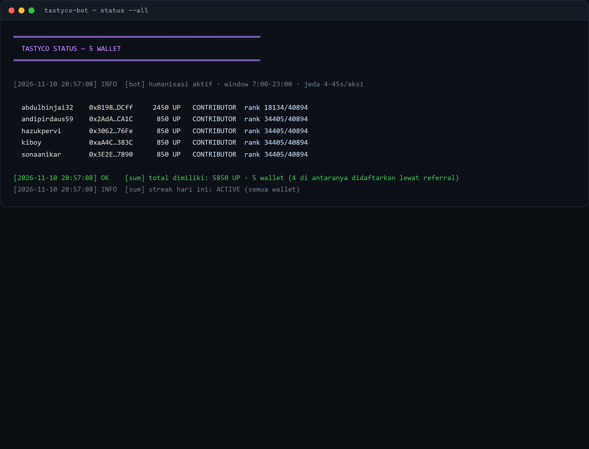
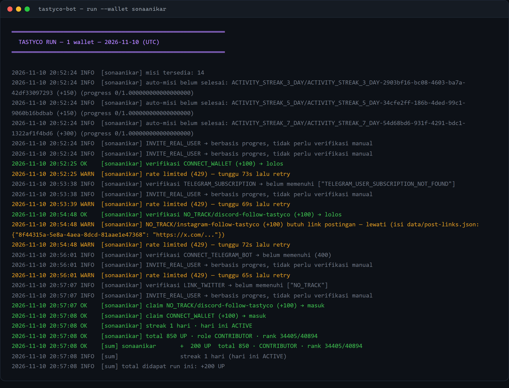
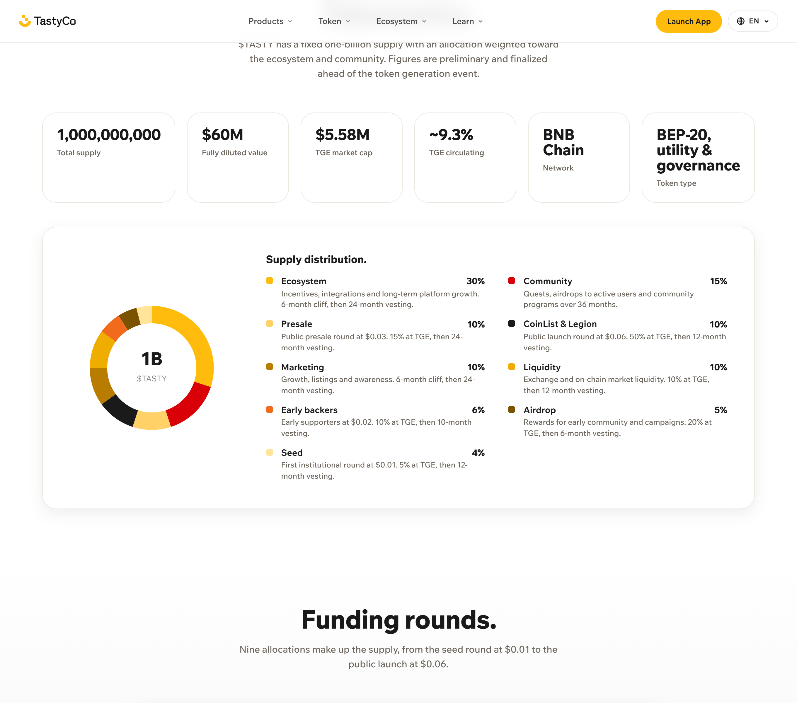

# TASTYCO BOT — LYID Automation

Automation for **TastyCo** (`app.tastyco.io`), the on-chain exchange for tokenized food brands on
**BNB Chain**. The $TASTY airdrop is **confirmed**: $100,000 in $TASTY for the current campaign, drawn
from a 5% airdrop reserve, TGE targeted Q4 2026. 70% of the allocation is scored from the TastyCo app
itself, 30% from Galxe / Zealy / TaskOn.

Built by [LYID — Layer Airdrop ID](https://t.me/layerairdrop) · Telegram [@rmndkyl](https://t.me/rmndkyl)

---

## Screenshots

Public set (wallet addresses masked, safe to publish). Unmasked copies of the two bot cards are kept
in the private repo under `docs/screenshots/private/` (gitignored here on purpose).

**Five wallets, one of them the original account and four registered through its referral link.**
Real `status --all` output, 2026-11-10:



**A real daily run** — daily ladder claimed, quiz solved from metadata, payouts collected:



**Project side** — 5% of a 1B supply is reserved for the airdrop, TGE targeted Q4 2026:



---

## Proof it runs

Not a mockup — these are the bot's own numbers, measured on live accounts:

| Action | Endpoint | Result |
|---|---|---|
| Daily reward ladder day-0 | `POST /daily-rewards/claim` | `201 true` → **+500 UP** |
| Weekly education quiz (3/3) | `POST /mission-activity/{id}` + `missionAnswer` | `{"success":true}` → **+150 UP** |
| Completed-quest payout | `POST /mission-reward/{id}` | `201 "true"` → **+100 … +200 UP** |
| Login (SIWE + Turnstile) | `GET /user-auth/login` | tokens issued, session valid 30 days |

Running total after the first pass: **2450 UP** on the original account, **850 UP** on each of the
four referred wallets — **5850 UP across 5 wallets** in one day, with four of them not yet having
Telegram or X bound.

The quiz answers were not guessed: the mission metadata ships `correctOption` for every question
(`q1=1, q2=1, q3=1` on the 2026-11-10 rotation), and the bot reads it at run time.

One non-obvious rule cost real points until it was fixed: a quest whose `progress >= amount` is
**still in `filter[status]=AVAILABLE`** and pays nothing until `POST /mission-reward/{id}` is called
explicitly. Checking only `status=COMPLETED` leaves roughly 200 UP per new wallet on the table.

---

## What actually earns points

Read off the live API (`GET /missions`, `GET /daily-rewards/today-info`), not from a guide:

| Source | Points | Cadence | Automatable |
|---|---|---|---|
| **Daily reward ladder** | 500 → 1.000 → 5.000 → 10.000 → 15.000 → 20.000 → 25.000 → 30.000 → 35.000 → 40.000 → 45.000 → 50.000 | daily, day 0..11 | ✅ fully |
| **Education quiz** | +150 | weekly, resets | ✅ answers come from `metadata.quizQuestions[].correctOption` |
| **Activity streak 3 / 5 / 7 days** | +150 / +150 / +300 | weekly | ✅ by showing up daily (see *Humanization*) |
| Referral milestones (1/3/5/10/20) | +200 / +400 / +1.500 / +3.000 | once | ⚠️ needs *qualified* humans — see below |
| One-time social links | +100 … +200 | once | ✅ if the account is already bound |
| Community post on X | +150 | every ~3 days | ⚠️ needs the post URL (`data/post-links.json`) |

**Referral qualification is the hard wall.** The project's own copy states a referral counts only after
the invitee *connects Telegram, completes the quiz, takes a meaningful action, and passes anti-sybil
checks*. Wallet-only self-referrals therefore earn nothing, and a single funding source across many
wallets is exactly what their anti-sybil looks for. Do not treat referrals as free points.

---

## Install

```bash
cd ~/LYID-BOTS/tastyco-bot
npm install
node src/index.js import "C:/Users/raman/LYID-WALLETS/legacy-vault-originals-backup/TastyCo Airdrop.txt"
node src/index.js login --all      # once per wallet, opens Chrome for the captcha
node src/index.js run --all        # daily routine
```

Windows users: double-click **`JALANKAN.bat`** (Indonesian menu), **`CEK-STATUS.bat`**, or **`LOGIN.bat`**.

Requirements: Node 18+, Google Chrome installed (only for login), and a wallet already registered on
the TastyCo app with its Telegram/X bound if you want the +450 one-time social points.

---

## Commands

```
node src/index.js run --all                    daily routine, all wallets
node src/index.js run --all --slot             same, but only after each wallet's slot time (for cron)
node src/index.js run --wallet abdulbinjai32   single wallet
node src/index.js run --all --force            re-run even if already ran today
node src/index.js run --all --login            allow automatic login (opens Chrome)
node src/index.js run --all --link <id>=<url>  submit a post URL for a submission quest
node src/index.js login --all                  refresh/establish sessions (headful Chrome)
node src/index.js status --all                 read-only: points, streak, open quests
node src/index.js wallets                      list wallets + session state
node src/index.js import "<path>"              import from legacy LYID text vault
node src/index.js add andipirdaus59 kiboy      create fresh wallets (seedphrase AES-256)
node src/index.js register --all               register new wallets via referral + print TG/X links
node src/index.js links --all                  re-print the Telegram / X connect links
node src/index.js run --all --fast             maintenance only: skip humanisation delays
```

State lives in `data/`: `sessions.json` (tokens), `state.json` (one run per wallet per UTC day),
`run-log.jsonl` (audit trail), `post-links.json` (optional quest links).

---

## Humanization / anti-sybil design

The account is the asset. A pattern that looks like a farm can cost the whole allocation, so the bot
deliberately does less than it could:

1. **Deterministic per-wallet daily slot.** Each wallet gets a fixed visit minute inside the configured
   window (`07:00–23:00` local), derived from `sha256(address|date)`. Retries land inside the same slot,
   so a failed run does not look like a second visitor.
2. **Randomised gaps, skewed short.** 4–45 s between actions, weighted so most pauses are short and long
   ones are occasional — not a fixed metronome.
3. **Request budget.** A sliding-window limiter keeps every wallet under 12 requests/minute, and honour
   the server's 429 with a 65 s+ backoff (the API does throttle — it answered `ThrottlerException`
   during tracing).
4. **Task order shuffled** every run, with a random read-only "browsing" call mixed in, so the request
   sequence is never byte-identical twice.
5. **Wallet-level staggering.** Multiple wallets are spaced 120–420 s apart, never fired together.
6. **Optional rest days.** `humanize.dayOffChance` (default `0`) can make a wallet skip a day. It costs
   streak bonuses, so it ships off — turn it on only for deep-farmed wallets.
7. **No bug exploitation.** `POST /mission-reward/additionally-claim/{id}` is a dead endpoint the real web
   client never calls; in testing it paid a flat +50 UP repeatedly on already-claimed missions. The bot
   does **not** use it. Free points are not worth a flag on an account that is waiting for a TGE.
8. **One captcha per wallet per ~30 days.** Turnstile protects only login, and the access token lives 30
   days with a rotating refresh token — the daily routine is pure HTTP with no browser fingerprint at all.

What the bot refuses to fake: joining Discord/Instagram, posting on X, or creating referral rings. Those
are the actions a sybil filter actually correlates, and they are left to a human.

---

## API map (all verified live)

Base `https://api.tastyco.io` · Nuxt build `e198bc98` · Turnstile sitekey `0x4AAAAAAET4O64ulvE1G0s4`

| Call | Meaning |
|---|---|
| `GET /user-auth/wallet/login-request?strategy=ETHEREUM_SIGNATURE&address=` | challenge `{message, token}` |
| `GET /user-auth/login?strategy&address&message&token&signature&recaptchaToken&inviter` | issue tokens |
| `GET /user-auth/refresh-tokens` header `x-refresh-token` | rotate access+refresh |
| `GET /user-auth/me` | profile (`refCode`, `telegramId`, `twitterId`) |
| `GET /activity-streak/me` | streak + this week's per-day status (UTC days) |
| `GET /role-progression/me` | points, role tier, rank, unmet requirements |
| `GET /balances/main-hub` | UP balance (raw number in the body) |
| `GET /daily-rewards/today-info` → `POST /daily-rewards/claim` | ladder state → claim |
| `GET /missions?filter[progress]=true&…&filter[status]=AVAILABLE\|COMPLETED` | quest list |
| `GET /missions/conditions` | quest metadata incl. quiz `correctOption` |
| `POST /mission-activity/{id}` body `null` | re-verify condition, pays out on success |
| `POST /mission-activity/{id}` body `{"missionAnswer":"<json>"}` | quiz (`{"type":"quiz","passScore":3,"answers":[{"questionId","selectedOption"}]}`) or a post URL for submission quests |
| `POST /mission-reward/{id}` | claim a completed quest; body is a bare `"true"`/`"false"` |

**A quest with `progress >= amount` can still sit in `filter[status]=AVAILABLE` and pay nothing.**
Measured on a fresh account: `CONNECT_WALLET` (progress 1/1) and one `NO_TRACK` stayed AVAILABLE
with an empty `missionRewards[]`; calling `POST /mission-reward/{id}` paid +100 each. So the claim
loop must scan **both** COMPLETED and AVAILABLE-with-satisfied-progress, not status=COMPLETED only.

`missionRewards` populated on a mission = already paid. The bot skips those; that is why it does not
re-claim yesterday's quests.

---

## Troubleshooting

| Symptom | Cause / fix |
|---|---|
| `403 #CAPTCHA_REQUIRED` | Turnstile missing. Run `node src/index.js login` — daily runs never need it. |
| `Turnstile gagal: ERR:timeout` | Chrome window was closed, or the profile is stuck. Delete `data/chrome-profile` and retry. |
| `429 ThrottlerException` | Server-side throttle. The bot waits automatically; don't run several instances in parallel. |
| `201 false` on claim | Mission is not actually completed yet (progress < amount) or was already paid. Check `missionRewards`. |
| Daily reward says *sudah diklaim* | Correct — one claim per UTC day. The reset is 00:00 UTC = 07:00 WIB. |
| `MISSION_ANSWER_REQUIRED` on a NO_TRACK quest | That quest wants a post URL. Put `{"<mission id>": "https://x.com/<user>/status/<id>"}` in `data/post-links.json`. |
| Streak marked `UPCOMING` after a run | The activity for that UTC day has not registered yet; re-run after 00:00 UTC and check `status --all`. |

---

## Honest limits

- **The activity trigger is not isolated.** Every action taken on a UTC day marks that day active, but
  which one the backend counts could not be tested in this session (the current UTC day was already
  active from manual use). The bot logs the streak status every run; if a day ever shows `UPCOMING`
  after a full run, that is the signal to inspect further rather than assume.
- **The streak needs daily presence.** Missing a day resets it. A cron/Task Scheduler entry is the
  intended use, not manual clicking.
- **Submission quests need a human post** every ~3 days. The bot verifies and submits the URL; it does
  not write the post.
- **Referral milestones are out of reach** without genuinely distinct humans behind each invite.
- **Bulk runs hit the throttler.** Four wallets back-to-back stalled on repeated 65 s `429` waits and
  blew past a 7-minute budget. Run one wallet per invocation in production; the daily cron already
  spreads them across the day by slot. `--fast` removes only the artificial delays, not the throttle.

## Multi-wallet setup (current state: 5)

`wallets.json` holds five wallets: one original account plus four registered through its referral
link. Each one has its own session, its own daily slot, and its own referral code. Labels and keys
stay local — nothing wallet-identifying is committed to this repository.

The social half is deliberately manual, because that is the half anti-sybil actually correlates:

```bash
node src/index.js links --all      # writes data/connect-links.txt
```

That file gives, per wallet:

- a Telegram deep link (`https://t.me/tastycoio_bot?start=<uuid>`) — open it, press **Start**
- an X connect link (`/en/connect-twitter?token=…`) — open it in a browser already logged in as that
  wallet's X account

Bind Telegram and X per wallet and the +150 / +200 / +100 social quests unlock, the quiz already
counts, and the referral moves from *invited* to *qualified* (worth +200 to +3000 to the referrer).

What the bot will not do: create X accounts, join Discord/Instagram for you, or spin up referral
rings between your own wallets. Four wallets registered from one IP already share a fingerprint —
adding fake socials on top is what turns a defendable farm into a cluster flag.
